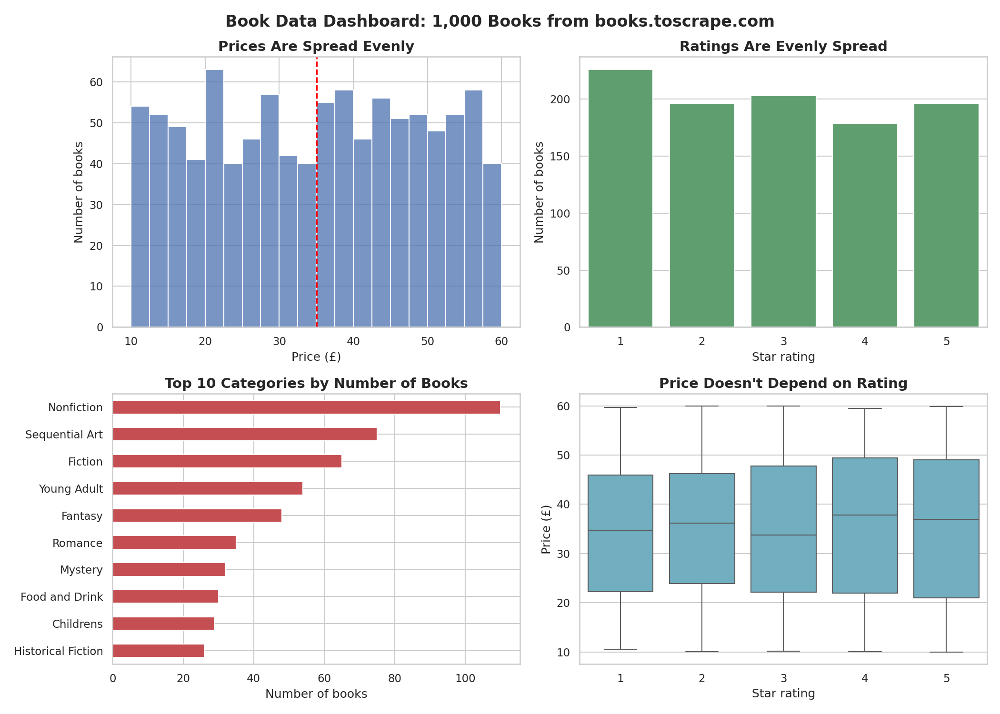

# CodeAlpha_DataVisualization# CodeAlpha Task 3: Data Visualization

## Overview
Visualizations and a data story based on 1,000 books scraped from books.toscrape.com (data from Task 1).

## Dashboard

## Charts Created
1. Price distribution (histogram)
2. Star rating distribution (bar chart)
3. Top 10 categories by number of books (horizontal bar chart)
4. Average price by category (horizontal bar chart)
5. Price vs star rating (box plot)
6. Summary dashboard combining the key charts

## Key Takeaways
- Prices and ratings are spread evenly, with no strong peaks
- Nonfiction is the largest category with 110 books
- Category barely affects price
- Price and rating are unrelated

## Tools Used
Python, Pandas, Matplotlib, Seaborn, Google Colab

## Files
- `CodeAlpha_DataVisualization.ipynb`: the full code and charts
- `dashboard.png`: the final dashboard
- `books_data.csv`: the dataset
